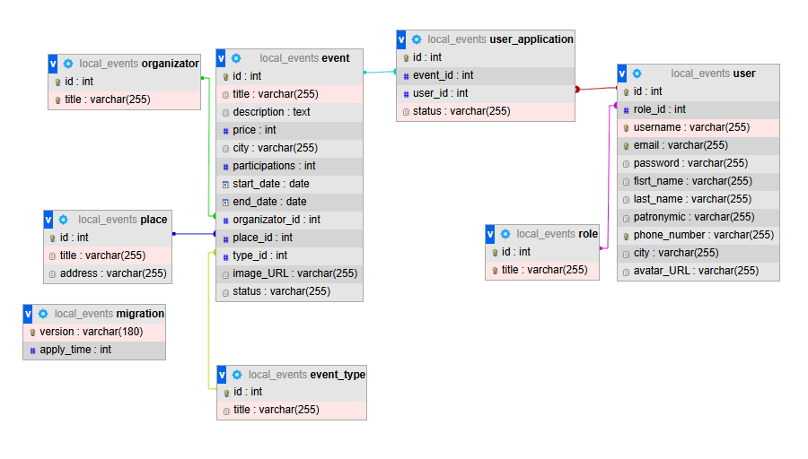
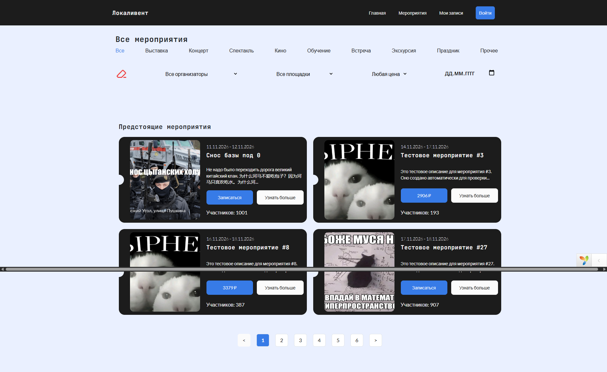
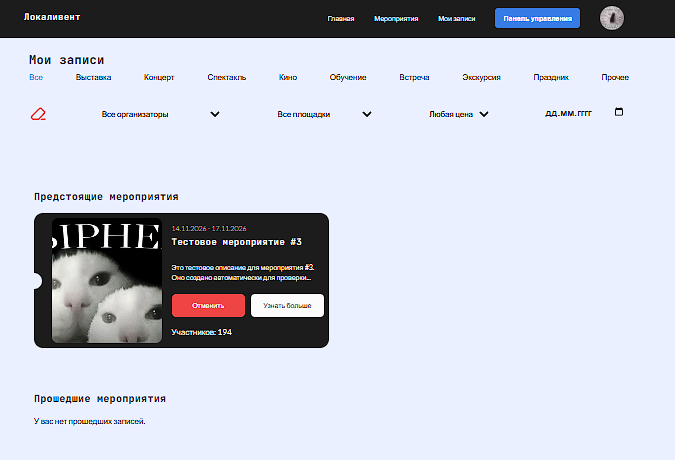
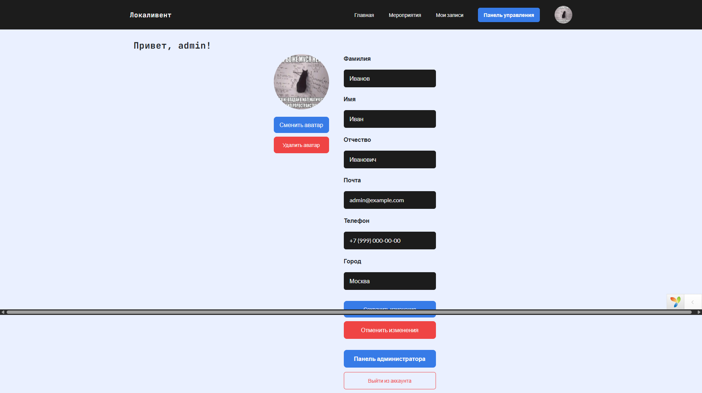
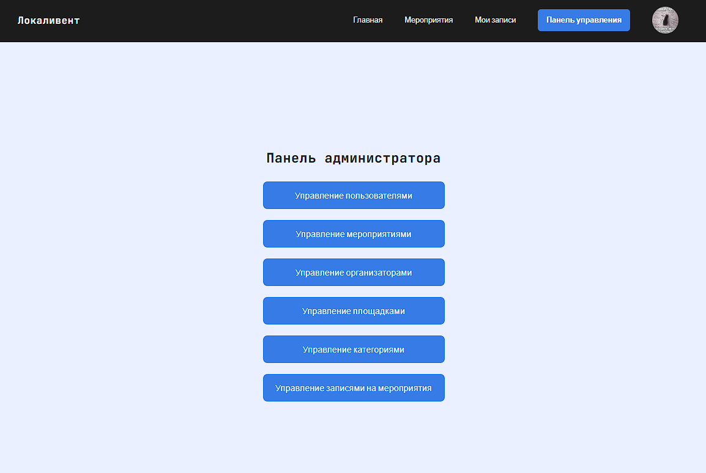
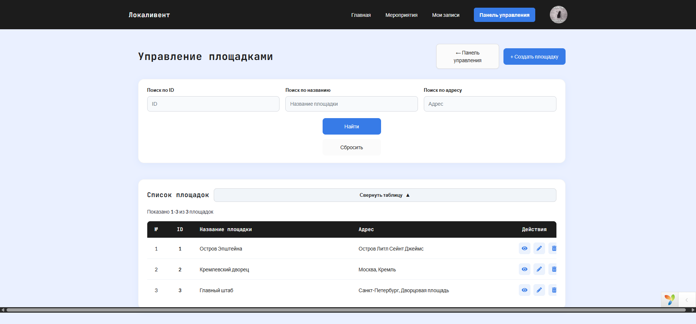

# Локаливент

«Локаливент» — учебный сайт для поиска мероприятий и записи на них. Проект создан в рамках учебной практики (1 семестр, 2026–2027 учебный год) на PHP с использованием Yii 2.

## Возможности

- Просмотр подборки предстоящих мероприятий и каталога с пагинацией.
- Фильтрация каталога по категории, организатору, площадке, дате и стоимости.
- Просмотр подробной информации о мероприятии.
- Регистрация и вход в аккаунт.
- Запись на мероприятие и отмена записи; просмотр предстоящих и прошедших записей в личном кабинете.
- Редактирование профиля и загрузка аватара.
- Панель администратора для управления пользователями, мероприятиями, организаторами, площадками, категориями и записями.

## Требования

- PHP 8.3 или новее.
- Composer.
- MySQL или совместимая СУБД.

## Развёртывание

### Локальный запуск

1. Склонируйте репозиторий и перейдите в его каталог:

   ```sh
   git clone https://github.com/miragiee/local-events.git
   cd local-events
   ```

2. Установите зависимости:

   ```sh
   composer install
   ```
   
3. Запустите Open Server, а также модули PHP и СУБД.   

4. Создайте базу данных (MySQL):

   ```sql
   CREATE DATABASE local_events CHARACTER SET utf8mb4 COLLATE utf8mb4_unicode_ci;
   ```

5. Укажите адрес сервера, имя базы, пользователя и пароль в `config/db.php`. Не используйте учётные данные из конфигурации по умолчанию для публичного или производственного сервера.

6. Замените `cookieValidationKey` в `config/web.php` на случайное секретное слово.

7. Примените миграции. Они создадут таблицы и добавят демонстрационные записи:

   ```sh
   yii migrate --interactive=0
   ```

## Структура базы данных

Миграции находятся в каталоге `migrations/`. База приложения содержит следующие таблицы:

| Таблица | Назначение и основные поля |
|---|---|
| `user` | Аккаунты: `username`, `password` (хеш пароля), `email`, имя и фамилия, отчество, телефон, город, `avatar_URL`; `role_id` ссылается на роль. В названии поля `fisrt_name` сохранена опечатка из текущей схемы проекта. |
| `role` | Роли пользователей (`title`), в том числе «Пользователь» и «Администратор». |
| `event` | Мероприятия: название, описание, цена, город, число участников, даты начала и окончания, изображение, статус и ссылки на организатора, площадку и категорию. |
| `event_type` | Категории мероприятий (`title`). |
| `organizator` | Организаторы мероприятий (`title`). |
| `place` | Площадки: название (`title`) и адрес (`address`). |
| `user_application` | Записи пользователей на мероприятия: `user_id`, `event_id` и статус. |
| `migration` | Служебная таблица Yii 2 для учёта применённых миграций. |

Связи: пользователь относится к роли; мероприятие связано с категорией, организатором и площадкой; `user_application` связывает пользователя с мероприятием. Внешние ключи настроены с каскадным удалением и обновлением.


> Схема БД

## Скриншоты


> Главная страница


> Страница со всеми мероприятиями


> Страница с записями на мероприятия


> Страница профиля пользователя


> Главная страница админ панели


> Пример страницы управления данными в таблице БД на примере управления площадками
